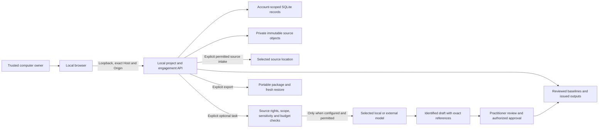
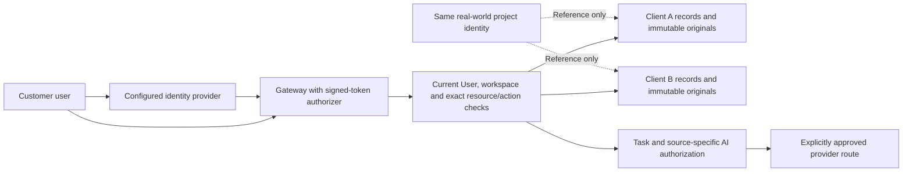

# Community architecture and data flows

E&S Review keeps the professional record independent of hosting, billing and optional AI services. This document describes the source candidate's actual module boundaries. Publication rights, platform support and deployment acceptance are separate decisions; see [security boundaries](security.md) and the candidate manifest.

The Community edition is prepared as E&S Risk Management Core. Its compact workspace connects one project/engagement record to source versions, findings, review, actions and monitoring. Supported extensions preserve that record and its permission checks.

## Runtime and technology scope

| Layer | Default Community profile | Optional or separate work |
| --- | --- | --- |
| Browser | Authored JavaScript/CSS, compact lists and browser/system fonts. | The broader static site uses Observable Framework; its build/hosting is not required locally. |
| Service and records | Node.js 24.22.1+, built-in SQLite, six vendored categori components and immutable private objects. | Authenticated collaboration uses the separate customer-configured API profile. |
| Documents | ExcelJS and jsdom for supported source/report workflows. | Python parsers, LibreOffice, Poppler, Tesseract, GDAL and fonts are explicit local capabilities. |
| AI and cloud | Manual work requires no model, cloud account, worker or subscription. | Local/external AI and optional AWS SDK adapters remain permission- and deployment-scoped. |

[Technology acknowledgements](../../ACKNOWLEDGEMENTS.md) record upstream credits, licence evidence and concrete unresolved dependency/provenance entries. The package lock defines this profile's graph; an app-wide notice inventory does not imply every recorded component is installed.

## Deployment profiles

| Profile | Application and storage | Identity boundary | Current evidence |
| --- | --- | --- | --- |
| Local Node or Linux container | One loopback application; private SQLite records and immutable objects outside the application/image | One trusted computer owner. Account labels partition custody; they do not authenticate other OS users. | Installed synthetic workflow, exact sources, export/restore and Linux container checks. |
| Customer authenticated API | Editable Gateway/service source plus customer-controlled identity, database and object adapters | Verified issuer/subject, current identity state and exact resource grants | Generic source and local synthetic adapter checks. Real JWT, IAM, frontend configuration, customer deployment and recovery require acceptance. |
| Maintained hosted service | The same core records with separately operated infrastructure, updates and support | Deployment-specific authenticated controls | A proposed operating model; this package does not provision a service, subscription or support commitment. |

The [customer AWS reference](customer-aws.md) supplies a dedicated loopback-host topology. The [optional authenticated profile](authenticated-profile.md) supplies a separate API topology. Neither converts the loopback listener into a shared-user application.

## Authorities and interfaces

| Responsibility | Source and contract | Boundary to preserve |
| --- | --- | --- |
| Professional workflow | `src/lib/engagement-domain.js`, `server/engagement-engine.mjs`, `server/engagement-store.mjs` | Requirements, exact citations, findings, actions, human review, approved baselines and monitoring retain their identities and history. |
| Project and financing context | `server/project-lifecycle-store.mjs`, `types/project-lifecycle.d.ts` | One real-world project may be referenced by several confidential engagements. Business relationships and approvals do not grant evidence access. |
| Shared identity vocabulary | Vendored workspace contracts and authentication client | Reuse authority-qualified User, workspace and resource references. Preserve the vendored licences/notices; names and emails are not identity joins. |
| Document custody | `server/local-account-workspace.mjs`, `server/local-workspace-store.mjs`, `server/engagement-sources.mjs` | Storage location, source version/hash, source permissions and application access are distinct. A reference alone does not retain bytes. |
| Authenticated authorization | `server/gateway-handler.mjs`, `server/access-service.mjs`, customer entry under `deploy/community/authenticated/` | Verify the current identity and exact action/resource before provider access. Sharing one document does not share its project. |
| AI execution | `server/es-ai-gateway.mjs`, `server/es-ai-service.mjs`, `server/es-ai-providers.mjs` | Explicit routes, source permission, task scope, sensitivity, budget and cancellation precede processing. No model is required for manual work. |
| Professional AI skills | `src/lib/es-ai-skills.js` and output schemas | Model output is a validated proposal. Exact source references and uncertainty survive review; a proposal cannot authorize itself. |
| Templates and reporting | `server/client-template-studio.mjs`, engagement renderers and issued renditions | Derive formats from canonical findings and approved baselines. Source forms and specialist content retain their own rights and qualification requirements. |
| Hosted operations and billing | Customer/operator responsibility outside this source profile | Credentials, live storage bindings, invoices, tenant operations and confidential content do not enter the Community package. |

## Local processing path

Manual assessment does not traverse the provider path. Intake, AI processing, sharing and public redistribution are separate actions. An external model receives only the material permitted for the selected task; enabling it requires a separate provider/routing decision. Optional document tools run for explicit work and report unavailable capability when absent. No idle queue worker is required.

The data directory holds client records and retained originals. Container layers hold software. The operator stops the app before a consistent full-directory backup; application export and a full-volume backup have different scopes. See [installation and recovery](install.md).

The selective source export contains no retained research capture or source-reference registry. Both registries start empty; the generic provenance normalizers still accept permitted user-owned metadata without granting redistribution or source access. Anonymous publication reads use the local origin or an explicitly configured customer AWS endpoint, with no maintainer API exception.

## Authenticated processing and client separation

The shared project identity never supplies a cross-client read. An explicit current grant, exact recipient/resource scope and source rights are needed for sharing. Storage readers, retrieval indexes, AI context/history and exports must enforce the same boundary. A cloud administrator's effective infrastructure access remains an operational responsibility; the diagram does not imply that administrators cannot read customer content.

The generic adapter leaves shared cross-application identity enrollment and hosted native-processing functions unconfigured. It requires customer identity, origin, resource authority, storage and IAM parameters. The local fixtures simulate the trusted-authorizer/provider boundary; they do not test a real signed token or deployed customer policy.

Customer offline-copy preparation, reconciliation and renewal fail explicitly with HTTP 503 until a customer-specific issuer/frontend adapter is qualified. Their source remains inspectable; that unavailable optional path does not disable online authenticated sources, engagements or review editions.

The configured resource authority is passed through original registration, engagement source projection, resource indexes/connections, field ingestion and new review editions. Foreign authorities fail the current source checks. Historical field verification compares frozen descriptors with exact retained manifest and media bytes; reopening a package never rewrites its original authority. Customer browser adapters must supply the explicit resource authority when configuring field receipts; an uploaded reference cannot select it.

## Public extension surface

Use the existing same-origin project/engagement commands and exchange routes rather than writing storage files directly. Schemas under `schemas/` describe the data and command boundaries. The shipped `docs/lifecycle-architecture/openapi.json` describes the six lifecycle API paths; it is not a complete OpenAPI specification of every project or engagement route. Read the corresponding server handler for routes outside that specification.

Compatible commercial or third-party modules use these same records, versioned capabilities and supported namespaced extensions. Unavailable adapters report unavailable rather than silently uploading to a paid service or changing record authority. [Extension guidance](extensions.md) explains source references, templates and processing permissions.

The source manifest binds every shipped file and profile transformation. Application-owned Community source is licensed under [Apache-2.0](../../LICENSE); existing vendored licences remain in force. A matching published upstream workspace-contracts alpha.11 is not claimed; that provenance limit is separate from permission to export categori.se’s own recorded modifications. Source publication supplies no professional, independent security or customer deployment acceptance.
